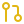

# Original Game Soundtrack Database

**Every game. Its official soundtrack. Where to stream it.**

An open, community-maintained database of official video game soundtracks,
with links to Spotify, Apple Music and album.link.

<!-- STATS:START -->

<!-- STATS:END -->

---

##  What is OSTDB?

Finding the *official* soundtrack of a game is surprisingly hard: fan uploads,
missing albums, region-locked releases, multiple volumes. OSTDB fixes that with
one open dataset that maps each game to its official OST albums and the places
you can actually listen to them.

-  **Official releases only**: no rips, no fan uploads
-  **Streaming links** for Spotify, Apple Music and album.link
-  **Open data**: JSON, CSV, SQLite and a REST API
-  **Community-driven**: anyone can add a missing soundtrack

##  Projects

| Repository | What it is |
| --- | --- |
| [**soundtracks**](https://github.com/OSTDB/soundtracks) | The open database itself: games, their OSTs and streaming links |
| [**Claude_Plugin**](https://github.com/OSTDB/Claude_Plugin) | Search game soundtracks straight from Claude |

##  Contribute

Missing a soundtrack, or found a broken link?

1. Check the [soundtracks repo](https://github.com/OSTDB/soundtracks) to see if the game is already there
2. [Open an issue](https://github.com/OSTDB/soundtracks/issues/new) or send a pull request
3. That's it, the next person looking for that OST will thank you

##  Use the data

Building a game library app, a Discord bot or a music widget? Grab the data as
JSON, CSV or SQLite from the [soundtracks repo](https://github.com/OSTDB/soundtracks),
or use the [REST API](https://ostdb.net/api).

The data is licensed under [CC BY-NC-SA 4.0](https://creativecommons.org/licenses/by-nc-sa/4.0/):
non-commercial use, with credit and a link to [ostdb.net](https://ostdb.net).

---

Made with  in the Czech Republic · <a href="mailto:company@ostdb.net">company@ostdb.net</a>

